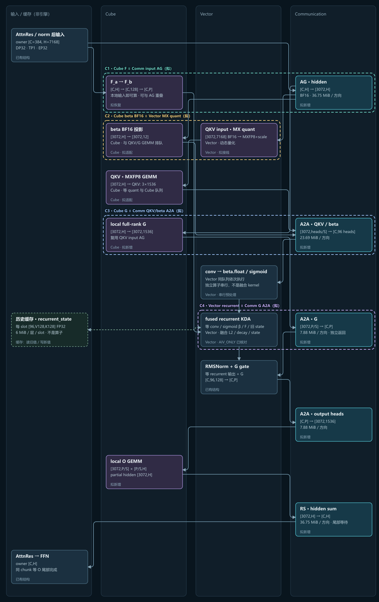
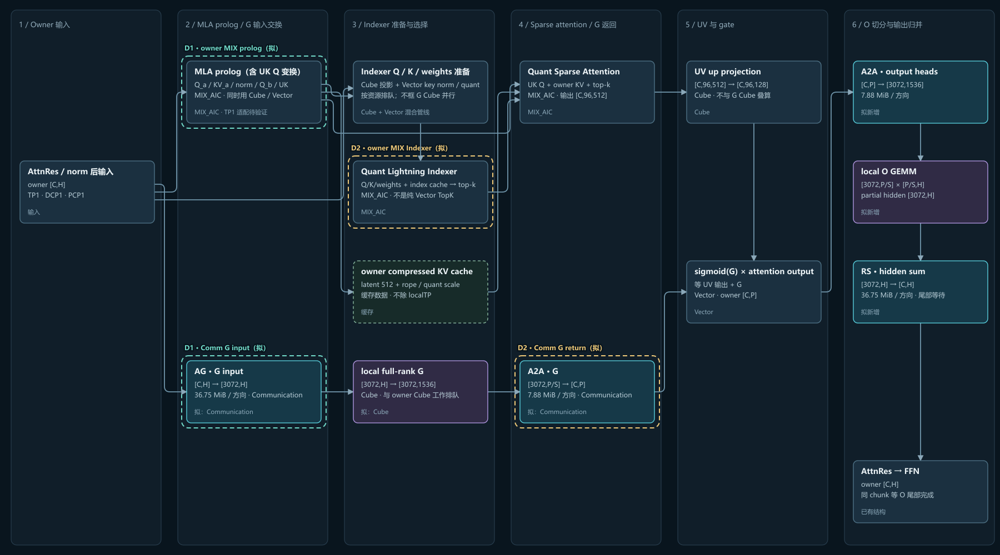
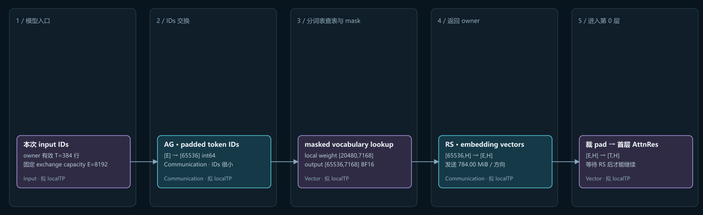
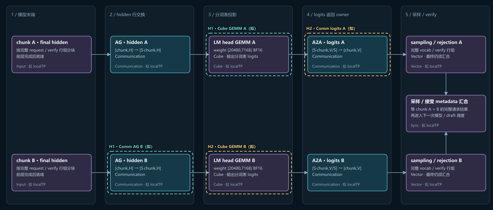
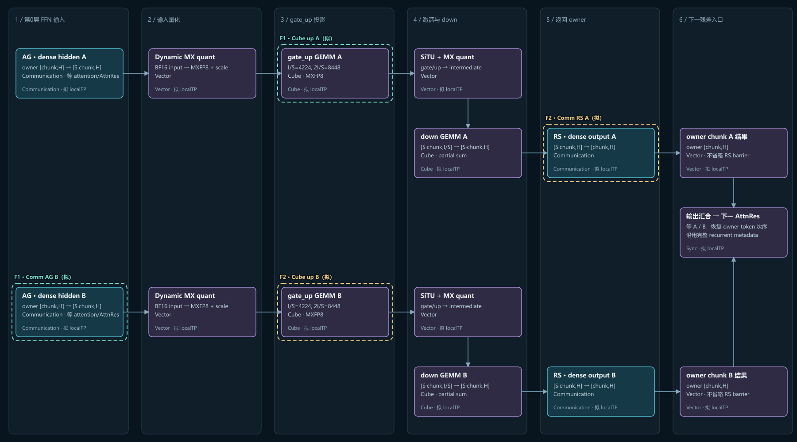
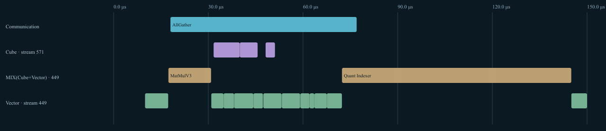

# Kimi K3.1 · A5 纯 DP / localTP 分析

本轮分析的公开入口：权重显存、计算通信依赖、Cube/Vector/Communication 多流，以及本地 DCP profiling 对照。

**交互网页：[打开 A5 分析](https://dawn952.github.io/kimi-k31-a5-analysis/)**（公开访问，无需登录）。仓库内图文可直接阅读；`docs/index.html` 是可下载离线打开的单文件交互页，无运行依赖。

**新增：[六类细粒度 TP 软件设计](design/README.md)**。明确独立 G 开关、KDA 重构、DP32TP1 全开/部分关/全关路径、权重加载、graph/idle rank 与64组合验收。已复制 [PR20574 固定版本公共源码](references/pr20574/README.md)；当前是设计及参考代码，尚未接入推理服务。

## Gating G 是否与 O 一样大

A5 实际量化 checkpoint header 确认：attention 输出 G 与 O **均为 BF16，每层均为168 MiB**。`12288 = 96 heads × 128`。维度顺序相反，数值独立、不共享权重。

| 权重 | 完整 shape `[out,in]` | localTP8 shape | 完整 / 每卡 |
|---|---|---|---:|
| G | `[12288,7168]` | `[1536,7168]` | 168 / 21 MiB |
| O | `[7168,12288]` | `[7168,1536]` | 168 / 21 MiB |

每层各88,080,384参数。69个KDA层和24个DSA层合计93层，G、O各15.2578125 GiB，切8份后各1.9072265625 GiB/card。核对数据：[weight-shapes.json](data/weight-shapes.json)。

## KDA：资源泳道与同框多流

不再按旧的1～5阶段划分。数据/缓存单独放置，Cube、Vector、Communication各有泳道；同框表示新方案中可按依赖接线的跨引擎窗口，图不是实测时长比例。

| 并行组 | 配对 | 必须保留的等待 |
|---|---|---|
| C1 | input AG ↔ 本地 F_a/F_b | QKV要AG；recurrent要F |
| C2 | MX quant Vector ↔ beta BF16 Cube | QKV要量化输入，Cube队列仍串行 |
| C3 | QKV/beta A2A ↔ G GEMM | conv/beta处理要owner QKV/beta |
| C4 | G A2A ↔ RecurrentKDA Vector | 输出gate要G与core都完成 |

conv、beta后处理、recurrent共同占Vector，按队列执行。连续F_b输出的reshape通常仅view；`recurrent_state`是历史状态缓存，单层单slot为`[96,128,128] FP32`、6 MiB，读旧值与写新值在recurrent kernel内完成。

G ready后尽早发返回；若它已在conv阶段结束，不能重复计算为recurrent的隐藏收益。beta比原BFG小，不能沿用BFG时长宣称量化全被覆盖。A5旧DCP A2A记录有CCU_LAUNCH推进证据，新消息仍需核验相同路径。

<details><summary>展开 KDA 资源泳道图</summary>



</details>

## DSA：按实际 MIX_AIC 路径重画

prolog、量化Indexer、Sparse Attention在DCP样本中均为`MIX_AIC`，不能把整段当纯Vector与G Cube叠算；UV也占Cube。

方案A主要寻找G input AG与owner prolog、G return与Indexer/SFA计算的通信窗口；G GEMM本身仍要与owner Cube排队。方案B把G留在O shard消费，省掉G return，可将G GEMM推迟到O heads A2A窗口；需保留输入buffer。

<details><summary>展开 DSA 方案图</summary>



</details>

## Embedding / LM head / Dense MLP 在哪里掩盖

| 模块 | 位置与整块依赖 | 分块候选 |
|---|---|---|
| Embedding | 模型入口：IDs AG → lookup/mask → vectors RS | 没有同批独立Cube支路；先审查过量padding，不画假掩盖 |
| LM head | 模型出口：hidden AG → GEMM → logits A2A → sampling | GEMM A ↔ hidden AG B；logits A2A A ↔ GEMM B |
| Dense MLP | 第0层FFN：AG → quant → gate_up → SiTU → down → RS | GEMM A ↔ input AG B；RS A ↔ GEMM B |

后两者的跨chunk图是**待实现**方案。保留各chunk依赖及最终owner行次序/采样metadata汇合；需要双buffer、异步collective、全rank一致调用顺序。分块增加launch、权重重读并可能降低小M效率，不能只计算隐藏通信的收益。首层dense没有shared/routed双支路，不能照搬shared MLP掩盖结论。

<details><summary>Embedding 图</summary>



</details>

<details><summary>LM head 两块流水候选</summary>



</details>

<details><summary>Dense MLP 两块流水候选</summary>



</details>

## DCP 设备观察

样本为2026-11-05，metadata确认TP8/DCP8/EP32，query shape为168行。排除首个target step：DSA为504个层样本，外围模块为21个主模型调用。采集commit未确认。

| 旧DCP通信 | 包络中位 μs | 与设备计算的区间交集中位 μs |
|---|---:|---:|
| DSA query AG | 58.56 | 57.96 |
| DCP TopK候选AG | 69.07 | 0 |
| DCP output A2A | 179.45 | 0 |
| 主模型 embedding AR | 628.45 | 0 |
| LM head logits AG | 152.42 | 0 |
| Dense input AG / output RS | 15.45 / 29.63 | 0 / 0 |

communication envelope包含控制、等待和rank不同步；不是净传输时间，区间交集也不是端到端省时，不能用来直接拟合新拓扑带宽。主模型embedding的包络波动尤其明显。

旧DCP当前G投影在UV之后，中位28.51 μs。可研究前移到候选AG或output A2A空窗，同一个G只计一次；这两种DCP通信在pure DP中消失，不能挪用到新方案预算。



## 权重与方案口径

纯DP为DP32/EP32，TP=PCP=DCP=PP=1，localTP8是DP轴内子组。沿原表递进权重为100.183 → 86.832 → 82.393 → 69.043 GiB/card；叠加既有shared切分为58.828 GiB/card，已含EP32 routed experts。这里是权重估算，不能当总HBM峰值。

示例`C=T=384`、embedding capacity `E=8192`、head rows `L=384`均为明确标注的对比输入，不是新拓扑测量。均衡时1/8权重处理8个owner的token，GEMM FLOPs基本不变。所有新方案耗时仍需实测。

## 来源与本地验证

- A5分析源码版本：`30572def8290cf08b300a2326b09f9c4abe8f30f`；上游vLLM：`24420b7a341af37a9bc3186e6fc6062512e0aa58`。版本号用于定位分析基线，运行环境源码不包含在此公开产物中。
- 权重核对：实际量化checkpoint的tensor header汇总，见`data/weight-shapes.json`。
- DCP精简事件与统计：`src/dcp-overlap.js`；原始trace、权重和机器信息未包含在此产物中。
- [GLM localTP参考PR](https://github.com/vllm-project/vllm-ascend/pull/20574/)；[CANN kernel类型定义](https://www.hiascend.com/doc_center/source/en/CANNCommunityEdition/900/API/ascendcopapi/atlasascendc_api_07_0218.html)。

无需依赖安装：

```bash
node scripts/build.mjs
node --test tests/*.cjs
```

后续本地修改会同步此仓库，并核对GitHub Pages发布结果。
