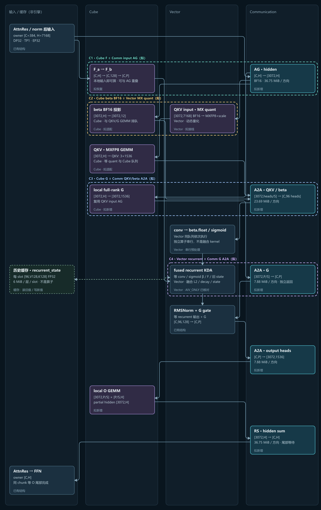
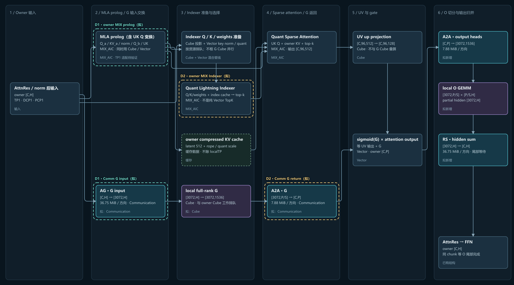

# A5 六类细粒度 TP 软件设计

实现已提交上游 **[Draft PR #21624](https://github.com/vllm-project/vllm-ascend/pull/21624)**，目标为当前 `vllm-project/vllm-ascend:main`，基线 `c251a6a5ed5cc10f7ec6daa5b87d410d731bf6fd`。本页继续作为同一设计与验收入口；现有推理服务未切换到新代码。

## 实现与验证状态

- 六独立开关已接线；G 独立于 O，QKV/G 全关保留原 BFG，attention state 不随 projection group 切分。shared MLP 不改。
- 同一 maintainer 完成四轮对抗审查，发现的问题已修复并复核。重点修正：采样期不依赖 current-config scope；NoPE PIECEWISE 的 O 保留裁剪前 graph 容量；runtime idle 与 active 在 DP dispatch 后一并拒绝非法 eager；空行 head reshape。
- A5 匹配 vLLM 环境的相关单测 **950 passed / 2 skipped**；按文件要求隔离运行的 CPU 编译测试 **8 passed**。其中实际执行器验证全部64组合、32个模拟owner及27种不同QKV/G/O大小。
- **两卡 NPU 验证通过**：64组合、真实 Kimi MXFP8 merged loader/post-load/apply、独立 G、全开 raw NPU graph capture/replay，以及实际 SFA 包装层/O/HCCL 的不等长与空闲 owner。该测试使用小权重和合成 attention/prolog，不是完整 Kimi 或真实 recurrent 内核精度验收。
- **仍待设备验收**：完整 DP32 checkpoint、真实多步 state/logits、旧拓扑硬件回归、峰值 HBM、长稳和端到端性能。图中的窗口仍是依赖可行性，不能当成已实测的收益。
- PR 保持 Draft、未 merge。`format.sh ci` 的 Python/Markdown等检查通过，完整本地命令受 actionlint Go 下载、Windows shell hook 和 shellcheck 环境限制，仍需 CI 验证。

## 设计裁决

- 新增独立 `gproj_tensor_parallel_size`，默认1；保留 O 开关只控制 O。QKV/beta 共用 PR20574 的 `qkv_iproj_tensor_parallel_size`，默认1。其余四个开关复用已有字段。
- KDA 采用**原类内抽取公共 core、组合细粒度投影执行器**的重构方式，复用现有 conv/recurrent/spec/state-copy 内核。投影的 localTP 与 KDA state 的 TP×PCP 分区彻底分开。
- 第一版以既有图中的**方案A：G 返回 owner**为功能基线，支持六开关全部组合。保留方案B“G/O 同 shard 消费”为后续融合优化；它不能成为 G 或 O 独立启用的前提。
- DP32/EP32、TP=PCP=DCP=PP=1、PD decode，六开关全设8为主验收配置。任意关闭一部分，剩余模块仍按各自配置执行；全关走原路径。shared MLP 的现有切分和多流保留，本轮不重做。

## 固定基线与已有接线缺口

| 基线 | 版本 | 用途 |
|---|---|---|
| A5 当前 Ascend 源码 | `30572def8290cf08b300a2326b09f9c4abe8f30f` | 本设计调用链和运行适配依据 |
| A5 当前上游 vLLM | `24420b7a341af37a9bc3186e6fc6062512e0aa58` | loader、模型与 runner 契约 |
| 上游集成目标 | `main @ c251a6a5ed5cc10f7ec6daa5b87d410d731bf6fd` | PR21624 的基线；替代此前讨论的私仓 K3.1 分支 |
| PR20574 | `66f79fede7980c1e1192796ef0af648fe9a13106` | 固定公开参考，不能用不断移动的 PR head 代替 |

A5 当前分支是 main 与 PR20878 相关提交的合并基线。实施已改在 upstream main 上完成，没有混入 A5 的完整 merge。下表是设计开始时的接线缺口；行号指 A5 分析版本，当前实现请以 PR21624 为准。

| 现状 | 位置 | 必须补齐的内容 |
|---|---|---|
| 已有 O、MLP、embedding、LM head 四个 size，缺 QKV/G | `ascend_config.py:1349` | 新字段、有效配置校验、模型能力校验、启动回显 |
| 相同 size 的细粒度 PG 会复用一个对象 | `distributed/parallel_state.py:200` | 增加 QKV/G 引用；统一 collective 顺序和去重销毁 |
| dense 非 MoE 层已有 gate_up AG / down RS | `ops/linear_op.py:263,286,407` | 核对 Kimi 第0层命中、双 chunk 流水；不改 shared 优先级 |
| KDA 混合量化 QKV 与 full-F/BFG 多流已经存在 | `ops/kimi_kda.py:211,368,389` | 替换投影执行器，拆开 core 与 norm 的等待点 |
| KDA PCP 自定义线性层显式执行 quant_method，绕开通用路由 | `ops/kda_parallel.py:31,70` | 新投影域明确传 group/rank/size；不能只开通用 O 开关 |
| DSA G 在 UV 后同步执行，之后 `_finalize_o_proj` | `attention/sfa_v1.py:2159` | G 分支前移，返回 owner 后 gate；适配 Kimi O 布局 |
| Kimi DSA standalone G loader 与 KDA BFG remap 有专门分支 | `models/kimi_k3/kimi_k3.py:1069` | 按实例选 loader，避免新 G 被再次装入旧 BFG |
| runner graph 防护只检查 O/MLP | `worker/v2/model_runner.py:191,796` | 加 QKV/G；保留 idle/dummy/LMhead join |

特别区分：**pure DP/PCP1 的 KDA 原 `RowParallelLinear` 可以命中通用 `OProjRowParallelOp`**；绕过通用路由的是 PCP 专用 `KDARowParallelLinear`，不能把它误称为 pure DP 已有 O 切分一定失效。方案A优先复用现有 O 通信算子，新增工作是验证/接通 Kimi owner 全头布局、独立分片域和 graph 契约；不另抄一套 O 通信。

## PR20574：已复制什么，哪些直接移植

[公共快照入口](../references/pr20574/README.md)已收录14个变更文件的完整 head、原始 diff、许可证及版本清单。下面是移植边界；**复制快照不等于已合入运行代码**。

| 公共实现 | 移植方式 | Kimi 必须改变的地方 |
|---|---|---|
| `FinegrainedTPConfig.qkv_iproj_tensor_parallel_size` | 复用字段名、默认值、非负/DP 整除校验 | 在显式 Kimi 分支校验 KDA 头数；本次仅接入 Kimi；GLM 的模型适配保留为公共参考，不宣称已合入本 PR |
| QKV DP 子组创建、getter、生命周期 | 在现有 PG 管理代码增量移植 | 再增加 G group；同组引用去重释放，collective 发起顺序统一 |
| `should_skip_allreduce_across_dp_group` 的 QKV 强制同步条件 | 复用“投影通信需要统一 token 容量”的原则 | QKV 或 G 任一启用都不能跳过同步；O/MLP 同样纳入当前 Kimi 执行计划；dense draft 的 `disable_tp` 语义保留 |
| `KDAInputProjectionTPLayout` 的 AG/A2A 与 head 重排 | 抽出不依赖 GLM layer 的布局方法，保留来源/版权 | 容量由 runner 给出，不能自己按本 rank 的 token 数选桶；支持 QKV/G 不同 group |
| `KDAInputProjectionTP.project` | 参考调用顺序，不整段原样替换 Kimi | GLM 一次 BF16 融合 QKV/beta/f_a/g_a；Kimi 为 MXFP8 QKV + BF16 beta + owner 低秩 F + full-rank G |
| KDA core/norm/output 分离与 UT | 沿用接口分层思路和参考通信测试方法 | Kimi 的 conv/spec/recurrent/cache hooks 保留；增加真实量化 loader 和 state 等价测试 |

PR 中 `async_op=True` 后仍在同一次 helper 调用中 `wait()`；这只能提供其内部工作窗口。不能仅因出现 async 就认定 Kimi 的 G 返回已经与 recurrent 重叠，必须把等待点移至 gate join。

## 开关与支持范围

| 模块 | 字段 | 开启后的范围 |
|---|---|---|
| dense MLP | `mlp_tensor_parallel_size` | Kimi dense FFN 的 gate_up / down，当前模型第0层；不包含 routed experts，不改 shared 分支 |
| embedding | `embedding_tensor_parallel_size` | `embed_tokens` 的词表维 |
| LM head | `lmhead_tensor_parallel_size` | 主模型 `lm_head` 的词表维；不误切 Markov/draft 禁用 TP 的 head |
| QKV/beta | `qkv_iproj_tensor_parallel_size` | KDA 的 Q、K、V、beta 按完整头切；不改变 DSA absorbed UK/UV、Indexer 或 KV cache 分区 |
| full-rank G | **`gproj_tensor_parallel_size`（新增）** | KDA 与 DSA attention output gate；不是 MoE router gate，也不是 FFN gate_up |
| O | `oproj_tensor_parallel_size` | KDA/DSA 输出 O 的输入头维 |

G/O 权重一样大不表示分片控制必须绑定。G 是 column projection `[P,H]`，O 是 row projection `[H,P]`；只开 O 时仍需 owner 完整 G，只开 G 时仍需 owner 完整 O，不同 size 时还要跨两种布局。因此**独立开关，复用通信组实现**是最小且足够的方案；不新增 beta、F 或多流环境变量。

`1` 为关闭；兼容旧配置 `0` 为关闭别名，进入计划时归一为1。负数、不能整除 DP/相关维度的 size 在启动时拒绝。已开启字段不得被静默改回1并当作验收成功。

主验收部署条件：Kimi K3.1 的当前混合量化格式；DP32/EP32，TP=PCP=DCP=PP=1，PD `kv_consumer`，decode-shaped step，graph 及其捕获容量覆盖最大 step。O/MLP 继续要求 `recompute_scheduler_enable=true`；第一版 QKV/G 与同一 decode/graph 契约对齐，避免新增未验证的 eager 路径。**仅 embedding/LM head 时，当前实现支持全局TP>1**：其词表分片由DP轴fineTP替换原native TP，而非两轴相乘。本次实际类CPU检查82项通过；采样互斥条件、显存含义及O/MLP/QKV/G为何限制TP1见[TP兼容性核查](tp-compatibility.md)。这不代表已做真实HCCL或完整模型设备验收。

新 Kimi 投影路径不支持的 TP/PCP/DCP/PP、模型、量化格式应启动时报清楚原因；**全部关闭时不得加这些限制**，原 TP8/DCP、prefill、eager 仍由原实现决定。

全开配置片段（不是完整服务启动命令）：

```json
{
  "finegrained_tp_config": {
    "mlp_tensor_parallel_size": 8,
    "embedding_tensor_parallel_size": 8,
    "lmhead_tensor_parallel_size": 8,
    "qkv_iproj_tensor_parallel_size": 8,
    "gproj_tensor_parallel_size": 8,
    "oproj_tensor_parallel_size": 8
  },
  "scheduler_config": {"recompute_scheduler_enable": true}
}
```

将这六个 size 改为1即为全关配置。保留部署已有的 EP、graph、KV transfer、量化等配置，不以该片段覆盖整个 `additional_config`。

## 数据布局与通信契约

令 `H=7168`，`N=96`，`D=128`，`P=N×D=12288`；`S` 是对应模块 localTP size，`C` 为本步**所有相关 rank 已对齐的 graph token 容量**，`T_r≤C` 为 owner 实际 token 数。owner 是原 DP 请求所在 rank，state/KV 仍归它。`[S,C,…]` 始终按 PG rank 顺序排列，不能把 DP 全局 rank 当组内 rank。

| 张量/权重 | 逻辑形状（S8 示例） | 通信后用途 |
|---|---|---|
| owner hidden | `[C,H]` | 只读，可同时给 input AG 和 owner F |
| gathered hidden | `[S,C,H] → [S*C,H]` | 当前 PG 内所有 owner 的 token |
| Q/K/V 权重 | 分别 `[P/S,H]`，各 `[1536,7168]` | 每卡计算所有 owner 的12个头；Q/K/V 必须分别按头切，不能直接均分整个 QKV 拼接矩阵 |
| QKV projection | `[S*C,3*P/S]` | A2A 按 owner 切行，再按 source shard 拼回 Q、K、V 各自完整头 |
| beta 权重 | `[N/S,H] = [12,7168]` BF16 | 与 QKV 相同 head map，返回后为 `[1,C,N]` |
| F_a / F_b | `[128,H]` / `[P,128]` BF16 | owner 执行 `[C,H]→[C,128]→[C,P]`，不经 localTP |
| G 权重/投影 | `[P/S,H]` / `[S*C,P/S]` BF16 | A2A 后 owner `[C,N,D]`，与 core 输出 gate join |
| O 权重/输入 | `[H,P/S]` / `[S*C,P/S]` BF16 | owner heads A2A 后做局部 GEMM，再 RS 得 owner `[C,H]` |

QKV/beta owner restore 的顺序契约：收到 `[source,C,3,local_heads,D]` 后置换为 `[C,3,source,local_heads,D]`；beta 独立为 `[C,source,local_heads]`。不可直接 flatten 为 source-major 的 QKV。混合精度先各自计算，再按相同返回 dtype 的实际输出打包；若不能在不改变精度下共包，就固定顺序分别 A2A，并更新通信账本，不把 FP32 beta 的通信按 BF16 计。

首选 beta **以 BF16 raw output 随 BF16 QKV 输出共同返回**，owner 再按原语义做 FP32 sigmoid；禁止为了共包把已 sigmoid 的 FP32 值降精度。QKV 输出 dtype 和 packed 行宽在加载/初始化时显式核对。

同一个 AG 只有在 **group 对象/rank 列表、输入 hidden 的值与版本、C、dtype、owner 行序和生命周期都相同**时可复用。KDA QKV/G size 相同可以复用；不同 size 分别 AG。DSA 没有 KDA QKV 输入 AG，G 需要自己的输入 AG；不能拿 attention 输出 O 的 A2A 代替输入 AG。

### 容量、通信组与 idle rank

- 在 runner 的既有 DP 元数据同步阶段选定一次 C；新热路径不做 NPU `.item()` 或临时 CPU 同步。QKV/G/O/dense 使用该 C。**不能各自 `max(local_tokens, local_capacity)` 后假定其他 rank 相同**。
- embedding 的既有 `E=max(potential_max_tokens,max_num_batched_tokens)` 和 LM head 的 `L=max_num_reqs×decode_query_len` 是不同契约，第一版保留，不能把它们强制设成 C。8192 与384的 embedding 成本问题继续单列，不靠缩小上限换正确性。
- 每个相关 rank 每步都加入 collective：`T_r=0` 仍发送合法 pad，参与完整 QKV/G/O/dense；core 仅处理实际 token，不能修改 padding 对应 state。全局无工作由 runner 统一跳过，不能各 rank 自行 early return。
- 沿已有 `[PP,DP,TP]` rank grid，在固定 PP/TP 上按 DP 连续分组。DP32/S8 为四个8-rank组；“local”须核对物理拓扑，不自动假定同节点。
- 相同 PG 的操作只在一个受控 communication stream 上按静态顺序发起；不同模块共享 PG 时不得从多个 Python stream 无序发 collective。QKV/G 输入 AG → QKV/beta return → G return → O heads exchange → O RS 为该层确定顺序，关闭的操作在全 rank 一致地删除；不同 size 的组也遵守统一逻辑发起顺序。
- `destroy_ascend_model_parallel` 按对象身份对细粒度 PG 去重销毁并清空全部别名。当前按字段逐个 destroy 的写法不能直接扩展为六次潜在重复释放。
- async Work/event/buffer 生命周期覆盖真正的通信完成；stream enqueue 不代表输入/输出可提前复用。通信 producer/consumer 都要有显式 event。ACL graph 使用设备侧依赖，不能依赖 Python 在 replay 时再次执行。

## KDA 重构与多流接线

不再让一个 `_forward_projections` 同时决定权重、通信、core 和 norm。沿现有 Ascend KDA 类重构，推荐职责如下；命名是拟新增接口，不是当前已存在的实现。

| 接口/对象 | 职责 | 不应拥有的东西 |
|---|---|---|
| `KimiFinegrainedTPPlan`（初始化后不可变） | 六个有效 size、PG 引用、布局与静态路径选择；初始化一次并回显 | 不按 token 临时改 config，不覆盖模型全局 TP |
| `KDAProjectionTP` | QKV/beta、owner F、G 权重与异步投影/返回；生成 owner-ready event | 不持有或切分 recurrent/KV state |
| `ProjectionResult` | owner QKV/beta/F，G owner buffer及 ready event，C/真实行数 | 不用 `None` 混淆“禁用”“idle”“通信尚未完成” |
| `_forward_core(qkv,f,beta,core_out,…)` | 原 conv/spec/recurrent、state copy和 connector hook | 不等待 G，不执行输出 norm/gate |
| `_forward_norm_gate(core,g,out)` | 等待 core/G 两个完成事件，逐头原始 RMSNorm + gate | 不重新做 G投影，不改变 epsilon/gate 公式 |
| O 接口适配（复用 `OProjRowParallelOp`） | 完整 owner heads → head A2A → local O GEMM → RS | 不调用 TP/SP 的第二次归约，不改 decoder token 语义 |

`state_parallel_size = 原TP×PCP`，`qkv_projection_size = S_q`，`g_projection_size = S_g`，`o_projection_size = S_o` 分开保存。DP32TP1 的 recurrent state 仍为本 owner 完整96头；不能把 `self.tp_size`/`local_num_heads` 改为8/12再让 state allocator 跟着切。conv、A_log、dt_bias、o_norm 的 owner 完整头参数同样不跟 QKV localTP 改分区。

旧 `_forward` 抽取 core 时保持 spec/non-spec token 重排、prefill/decode 分支、KV connector 等待和 state 写回顺序；旧入口仍“core → 原 norm/gate”。新入口在 gate 处才 join G。无 metadata 的 dummy 仍完成投影/O collectives，core 输出清零且不写真实 state。

### 全开 S8 的执行顺序与等待点



| 资源窗口 | 先入队什么 | 并行入队什么 | 在哪里等 |
|---|---|---|---|
| C1 | communication：只读 owner hidden 的异步 AG | Cube：本地 F_a→F_b | quant/beta 等 `input_ag_ready`；core 另等 `f_ready` |
| C2 | Vector：gathered hidden 的 MX input quant | Cube：同一 hidden 的 BF16 beta GEMM | QKV Cube 等 `quant_ready`；打包返回等 beta/QKV 都完成 |
| C3 | communication：QKV/beta A2A 返回 owner | Cube：G shard GEMM（复用 gathered hidden） | core 等 QKV/beta/F；G return 等 `g_gemm_ready` |
| C4 | communication：G A2A 返回 owner | Vector：conv/beta后处理→RecurrentKDA | norm/gate 才等 `g_owner_ready` 和 `core_ready` |
| 输出 | heads A2A→O Cube GEMM→RS | 该整块依赖链内不宣称自动掩盖 | decoder/residual 等 owner `[C,H]` |

beta 结果保留 BF16 raw，owner 做 FP32 sigmoid；F reshape 是 view，不当成可隐藏时间。Cube 队列内 F/beta/QKV/G GEMM 仍有资源次序；conv、sigmoid、recurrent 同属 Vector，不能把它们画成互相掩盖。通信仅在实际 HCCL/CCU 能独立推进时才获得跨引擎重叠。

G-ready 后尽早发返回，不为了画 C4 延迟通信；若 G 返回在 conv 中已完成，recurrent 阶段就没有额外可隐藏量。不得将同一段 G 通信重复计收益。

### 部分开关的真实路径

| QKV | G | KDA 投影路径 |
|---:|---:|---|
| 关 | 关 | 保留原 mixed QKV/full-F BFG 多流和权重；O 若开，只接 O 适配器 |
| 开 | 关 | QKV/beta localTP 返回 owner；F 改为 owner 低秩；G 为完整 owner BF16 GEMM，无 G collective |
| 关 | 开 | owner 完整 QKV/beta；F 为 owner 低秩；G 独立 AG→shard GEMM→A2A，不能继续保留旧 BFG 的 full G |
| 开 | 开 | QKV/G 组及容量一致则共享 AG；否则分别 AG；都还 owner 后进入原 core/gate 契约 |

O 与上述四行正交：O 关时 owner 全头直接原 O；O 开时向已有 `OProjRowParallelOp` 传完整 owner heads，保留其 A2A/GEMM/RS，不能事先再 `chunk` 一次。`S_q=4,S_g=8,S_o=2` 也必须按三个独立域还 owner 后衔接，不要求它们相等。

F 的低秩恢复只伴随新的 QKV/G 投影执行器；只开 embedding/head/dense/O 不擅自取消原 full-F。恢复低秩与预合成 full-F 的 BF16 舍入不完全相同，必须单列数值验收，不要求跨两种算法逐位一致。所有关闭时保留原权重、初始化与运算次序。

## DSA 的 G / O 接线



DSA 保持 absorbed UK/UV、query latent、Indexer、cache 和 sparse attention 的原 owner 计算，不把 KDA QKV 方案强套进去。`qkv_iproj_tensor_parallel_size` 对 DSA 不产生副作用。

1. 在 DSA forward 入口、owner hidden 尚在时启动 G input AG；与原 owner prolog 路径交错入队。G 关时不创建该通信。
2. AG 完成后调度 G shard Cube GEMM；prolog/Indexer/SFA 实测含 MIX_AIC，不能把 G Cube 与整个 DSA core 视为无资源冲突。对 G GEMM 的排队位置做 profile，第一版不依赖其一定被计算隐藏。
3. 立即发 G return A2A，与尚未完成的 Indexer/SFA/UV 路径形成通信窗口；原 UV 后的 `flash_attention_gate` 等 `g_owner_ready`。没有 local query 的 rank 也参加通信，pad 不写 cache。
4. gate 后继续经 `_finalize_o_proj` 的原非PCP入口调用 O 线性层，复用启用时的 `OProjRowParallelOp`，S_o 与 S_g 可以不同；O 关则该线性层为原完整权重。`_project_o_proj_full` 的方法名不表示其内部线性层不能命中 fineTP。现有 `_parallel_o_proj` 是 PCP 路径，不借用其名字把 localTP 混进去。

KDA/DSA 共用纯布局/异步交换工具并复用通用 O op；core、metadata、gate数学保留各自实现。方案B若后续接入，只有 G/O rank列表、头序、C等完全相同时才能在 O shard 处 gate；必须保留方案A支撑其他组合，且不得再走第二次 heads exchange。该融合届时才需要专用 O 入口；当前不提前新增。

## Dense / embedding / LM head 的接线与并行

| 模块 | 复用当前路径 | 本轮接线/实现要求 | 有效掩盖边界 |
|---|---|---|---|
| dense MLP | 非MoE `gate_up_proj` column / `down_proj` row | 第0层门控/上投影同 intermediate shard；SiTU 保留；down RS 返回 owner；关闭 TP/SP 路径不能额外归约 | 实现两 chunk：GEMM0 与 AG1、RS0 与 GEMM1；同 chunk 依赖不变 |
| embedding | `VocabParallelPlan.FINE_GRAINED` | 词表 shard、token IDs AG、mask lookup、vectors RS、裁剪；保留 vocab padding/新增token、多模态 masks及 `disable_tp` 优先级 | 本批没有独立 Cube 支路，不承诺通算隐藏；维持固定 E 正确性 |
| LM head | runner 固定 L pad → hidden AG → vocab GEMM → logits A2A | 双 chunk 返回保持 sampled-row 顺序；截词表 padding，保留 idle dummy logits、skip_gather与draft disable_tp | GEMM0 与 hidden AG1、logits A2A0 与 GEMM1 |

两 chunk 是细粒度路径内部的静态执行计划，不新增用户开关。先按**每个 owner 的行**分块再 AG，不直接将 source-major gathered buffer 随意切半；最终 `[chunk,owner,rows]` 必须恢复为 owner 行序。每个 chunk 的 padding、量化 scale、SiTU 参数与 spec 采样行索引相符。C/L只有1行时单块；其他合法容量按统一固定规则补齐，裁剪只发生在 owner 输出。

同一 PG 的发起顺序固定为 `AG0 → AG1 → RS0 → RS1`（dense）或 `AG0 → AG1 → A2A0 → A2A1`（head），compute 等各自输入事件。双 buffer 禁止覆盖在途输入；层/模块结束前排空本模块通信，避免与共享 PG 的下一模块交叉。graph capture/replay 保存同一计划。LM head 内仍恢复完整 vocab logits 给原 sampler，不引入新的分布式采样语义。

小 M 两块可能使 launch/权重重读增加，性能验收必须比较单块/两块；不宣称仅靠两块必然更快。embedding 暂不修改8192的容量契约；降低容量属于另一次经过全rank调度边界证明的优化。

## 权重加载、量化与内存生命周期

- 在创建权重之前决定有效计划。QKV/G 新路径不先创建完整旧 BFG 再切一份长期保留；权重驻留验收按 `named_parameters/buffers` 实际集合做账。加载瞬时峰值与常驻分别报告。
- checkpoint Q/K/V 各自按头 shard；MXFP8 权重与配套 scale/offset 按量化方法的真实布局同步切。block32 的量化分组与权重切轴需 loader 测试，不能对所有参数统一 `chunk(0)`。保留原 quant algo 解析用的逻辑 prefix，避免改名字后落到错误量化规则。
- beta、G、O 保持 checkpoint 对应 BF16，F_a/F_b 保持 owner 完整低秩参数。新 KDA 不再预合成 full-F；已有 full-F 仅在 legacy 路径保留。O 按输入列切，gate_up 的 gate/up 各自按同一 intermediate 轴切。
- 改 Kimi 的 `packed_modules_mapping`/`load_weights` 时按 layer 的执行计划选择映射；`.b_proj/.f_a_proj/.f_b_proj/.g_proj` 不能被旧 BFG remap 二次吞掉。DSA standalone G 和 scales/offsets仍调用该实例自己的 loader。检查“已消费 checkpoint key”与实际参数覆盖，禁止漏载后随机初始化。
- embedding/LM head 分别按 vocab shard 加载，不假定两个开关相等或权重绑定；若配置显式绑权重，需检查其布局是否兼容并给出明确处理，不能共享不同 shard 的 Parameter。
- core/state 所用 conv/A_log/dt_bias/o_norm、不切的 UK/UV 和 routed EP 权重保持原 loader；不重新制造已释放的 KV_b 权重，避免 UK/UV重复计数。
- gathered hidden、QKV pack、G send/recv、O partial、dense/head双buffer按执行计划复用，通信完成后才能复用。ACL graph地址稳定；额外激活/HCCL缓冲要单列峰值，不能从权重69.043 GiB直接推断可用总HBM。

主目标权重口径沿现表：六类切分并取消full-F、未叠加既有shared额外节省时约**69.043 GiB/card**；包含既有shared方案约**58.828 GiB/card**。仍需新路径实际驻留核对，数值不是新实现实测，不包含 state/KV/activation/graph workspace 峰值。

## graph、兼容性与失败策略

1. 配置层输出 request/effective size 及每类模块数量；对于本轮 Kimi 主配置，capture bound 不足直接启动失败，不能沿用当前把 O/MLP 静默改为1后通过验收的行为。其他模型原配置行为不顺带改动。
2. runner 的 graph-required 判定、decode-shaped scheduler、DP token同步加入 QKV/G；draft/target分开计划，已有 `disable_tp` 优先。all-on 主路径任何 eager fallback 应在 collective 前统一拒绝，不能一部分 rank运行一部分报错。
3. 新异步投影/core/O 使用现有可编译/custom-op 边界；新增 fake/meta 实现必须返回精确 shape/dtype，并声明 state/output mutation，不能让 compiler 把通信或 cache 写入优化掉。分离 core/norm 后保留 connector hooks 的既有 eager-break 位置。
4. capture、warmup、memory-profile dummy 都跑一致的集体序列；没有 attention metadata 时不能在 collective 前 return。replay只使用已捕获设备依赖，不能依赖 host Work 对象重新驱动。
5. 全关时不创建新增 QKV/G PG、不构造新投影执行器、不恢复低秩F、不加通信/事件/双buffer；旧 TP/PCP/DCP、spec、KV connector、权重 remap 和 O/SP融合入口保留。

## 验收矩阵：怎样证明全开、部分关、全关

本目录提供[布局参考检查脚本](check_reference.py)：用合成小矩阵验证 all-to-all 的 owner/head 映射、G/O 独立大小和6开关矩阵。它不导入 vLLM，不替代运行代码 UT/多卡验收。

| 层级 | 必须覆盖 | 通过条件 |
|---|---|---|
| CPU 参考/UT | 六字段1/8的全部64组合；旧0别名；负数/非法整除/不支持拓扑 | 正确分支，开启字段真正生效；全关完全 legacy |
| loader UT | 每个权重/scale slice，对比完整权重参考；S2/4/8 | QKV各子矩阵、beta头序、G行、O列、dense gate/up、vocab映射正确；无漏载/重复常驻 |
| 多rank参考 UT | DP32，QKV/G/O独立 S2/4/8；owner T不均、含0；多步state | owner 输出和 state 语义等价，不能只比shape；无跨owner行混合 |
| KDA核心回归 | spec接受/拒绝、非spec、metadata=None、connector/statecopy | 旧路径数值/调用顺序保持；新core只写实际owner state |
| A5 DP32 实机功能 | 64个二值组合均先做短请求多步；全开长稳、六个仅开/仅关重点加测 | 所有rank完成，无挂起，输出/采样/state正确，实际权重shape吻合开关 |
| graph与调度 | warmup/capture/replay、单rank idle/多rank idle、含pad/spec、多容量桶 | collectives各rank顺序和shape相符，fake/meta/alias正确，无eager失配 |
| legacy 实机 | 六项1、六项0、字段缺省；原TP8/DCP8和pureDP配置 | 无新增通信/参数/state布局，保留原精度和性能；相关旧测试通过 |
| 性能/显存 | 目标C384和实际容量分布，单块/两块对照 | 报权重驻留/加载增量/峰值HBM；设备trace证明C1～C4与chunk窗口，报告TPOT/吞吐而非只算字节 |

实机每项需记录 Ascend/vLLM commit、有效配置、实际tensor shape、HCCL通信模式和结果。BF16/O/RS的归约顺序和低秩F舍入会变化：按现有模型精度门槛比较logits/生成结果，另对KDA多步state做误差和稳定性检查。**未完成这些门槛前，不能声称DP32TP1全组合已保证通过。**

## 实施拆分与交付顺序

1. **公共底座**：从固定PR head移植config/PG/DP同步/布局与UT，保留GLM原测试；新增独立G字段，修同组生命周期；六项默认关闭。
2. **KDA接入**：抽取core/norm，分离state/projection域；按QKV/G四路径创建权重与loader；接C1～C4和O adapter，验证partial组合。
3. **DSA与外围**：G/O owner契约、dense原路由命中、embedding/head沿用现实现；补dense/head两chunk、idle/dummy与graph接线。
4. **验收收敛**：64组合UT/设备短跑、重点组合长稳、原TP/DCP回归；驻留/峰值与trace核对后再给性能结论。

后续推理代码从项目功能分支经fork Open PR交付，不自行merge。分析资料继续在当前公开仓库增量维护并同步Pages；公开快照只取上游公共源码，不发布运行环境私有代码。


## A3/A5、其他模型与 768-token 通信显存（2026-11-12）

核查版本为 PR21624 的 `4d4c9541695733e1ca2409ca5af8af24cd98a19d`。

- A3 校准 checkpoint 的 QKV 为 `W8A8_DYNAMIC` INT8，A5 为 `W8A8_MXFP8`；两者 beta/F/G 都是 BF16。新 mixed-layout 条件接受二者；A3 的 INT8 quant-overlap capability 与 A5 的 MX 路径分别沿用现有实现。**代码有两条路径，但只有 A5 两卡已做本次设备验证；A3 新切分尚未设备验收。**
- 新 QKV/G、KDA/SFA 和 dense/head 流水仅接入 Kimi；其他模型不能误开新 QKV/G 配置。全部关闭保留原算子路径。不过共用 `should_skip_allreduce_across_dp_group` 对其他 MoE 开启既有 O/MLP fineTP 的场景，也会强制 DP 元数据同步；公共 group teardown、runner dispatch guard 同样有覆盖。其正确性有相关 UT，不能宣称其他模型设备性能完全不变。
- 下列估算假设 DP32/EP32、TP1，各开启的细粒度 size 都为8。实际有六个配置字段；少开一个但其余 size 仍同为8，不改变 PG 数量。相同 size 复用一个 GroupCoordinator，每卡只属于一个 localTP8 子组，不按层数、开关数、stream 数相乘。
- `utils.py` 为这些普通 PG 显式设置 `hccl_buffer_size=200`，pg_options 优先于环境变量。`max_num_batched_tokens=768` 不会自动扩大它。按 CCL_In/Out 各200 MiB估，**细粒度 CCL 预算约400 MiB/card（0.391 GiB）**，并非整进程通信显存的实测值。如果原来已有同size的 O/vocab PG，新增 QKV/G 不再增加这份 CCL；若原来没有该组，则新增一份。
- EP/MC2/connector 既有通信域另算；MC2 特意不设置该 pg_options，仍可能使用 `HCCL_BUFFSIZE`。算法 scratch、收发 tensor、activation 和 graph pool 也不属于这400 MiB。

假设实际通信容量 `C=768`、BF16 hidden、H=7168、P=12288、96头、V=163840，张量大小如下，均为单个完整 tensor，**不能相加当峰值或CCL预留**：

| 张量 | MiB |
|---|---:|
| hidden AG 完整输出 `[8C,H]` | 84 |
| QKV/beta A2A 单边 `[8C,(3P+96)/8]` | 54.140625 |
| G 返回 / O 输入 A2A 单边 | 各18 |
| O RS 完整输入 `[8C,H]` | 84 |
| dense 两chunk之一的 hidden AG | 42 |
| LM-head 两chunk之一的 logits（BF16） | 120 |
| LM-head 两chunk之一的 logits（FP32 head输出时） | 240 |

普通 collective 可分段，显式 tensor 大于CCL并不自动改变配置。这里只说明当前200配置与数据量，未据此宣称最优大小。单独设置max_num_batched_tokens不能完全确定capacity：embedding取max(potential_max_tokens,max_num_batched_tokens)，LM head还受max_num_seqs、decode_query_len及DP同步结果约束；旧capture上限若仍大于768，应按实际容量重算。

依据：[pg_options优先级](https://www.hiascend.com/document/detail/en/Pytorch/2600/ptmoddevg/Frameworkfeatures/docs/en/framework_feature_guide_pytorch/setting_HCCL_communicator_parameter.md)、[CCL In/Out 与通信域复用](https://www.hiascend.com/developer/techArticles/20240903-1)、PR中的 `distributed/parallel_state.py`、`utils.py` 与 `ops/finegrained_tp.py`。此为源码/shape推算，尚未实测768全模型峰值。
