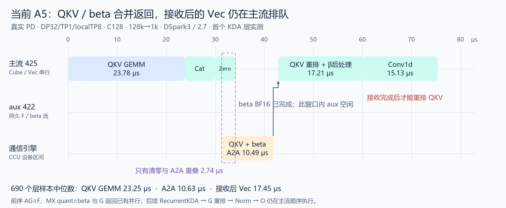
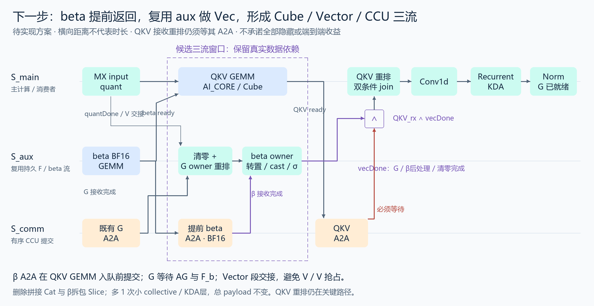

# A5 KDA：当前实测与三流修订方案（2026-11-13）

**当前问题已由代码和690个KDA层样本同时确认：QKV与beta合并A2A，接收后立即在主流重排QKV并处理beta，aux流未利用QKV GEMM窗口。不是“加一条流就能前移全部Vec”。** QKV接收重排需要返回的数据；beta后处理需要先解除与QKV返回的绑定。

本页对应实际部署的Ascend提交 `3634a7eae94897d1a7b14d00807323e5af6b4a04`、vLLM提交 `4ba787ec9959e566d3b587a796dff07673324da5`。真实P/D：P DP4TP8，D DP32TP1/localTP8；C128，I131072/O1024；DSpark preview 3步、固定采信2.7；CCU_SCHED。单rank capture含10次worker step、690次RecurrentKDA。以下方案未实现、未做新NPU测试；服务已经释放。

## 当前实现：实际执行流和时长



图上时长是首个完整KDA层的真实区间，表中是690个样本的中位数，不能混成同一个样本。CCU行是通信设备区间，CSV没有为其报告普通计算stream ID；不能把它当作CPU提交线程号。

| 设备区间 | 中位数 μs | 当前情况 |
|---|---:|---|
| QKV GEMM | 23.249 | AI_CORE；在主流运行，aux此时没有后处理任务 |
| 拼接QKV/beta的ConcatD | 5.680 | 必须在QKV GEMM后；发送端额外拷贝 |
| QKV/beta合并A2A | 10.628 | `all_to_all_single`，使用等长padding；不是两个独立的QKV和beta collective |
| 接收后AsStrided/Slice/Transpose/Cast/Sigmoid | 17.448 | 全部在主流；最早Vec平均还比A2A结束晚0.833μs |
| 清零与该A2A的区间交集 | 2.861 | 这是当前已有的局部重叠；不是整个A2A都被覆盖 |

完整前序为：owner输入AG与F_a/F_b并行；G等待AG和F_b后做BF16投影；G返回在CCU路径提前提交，与MX quant/beta BF16已有交集；QKV GEMM仍等待quant和beta BF16完成，避免两笔Cube工作相互挤占。随后是图中的串行段，再进入RecurrentKDA、G owner重排、gated norm和O路径。G返回首层只约9μs，早在RecurrentKDA前已经完成，不能再声称它被Recurrent隐藏了一遍。

BF16 beta/G GEMM在本样本标为MIX_AIC；MX quant标为MIX_AIV。它们不能被抽象成完全不共享资源的理想Cube/Vector算子，但实际trace确实记录了局部并行。拟覆盖的QKV GEMM本身标为AI_CORE，才是后续Vector工作更清晰的候选窗口。

## 哪些Vec可以前移

| 当前算子及归属 | 与同一笔QKV GEMM并行？ | 与QKV返回CCU并行？ | 改法/边界 |
|---|---|---|---|
| ZerosLike：输出buffer初始化 | 可以 | 可以 | 不读QKV；挪到aux，主流写该buffer前接回 |
| G owner Transpose：`[8,16,12,128] → [16,8,12,128]` | G返回完成后可以 | 可以 | 当前到Recurrent后才执行，改为aux提前物化 |
| beta owner Transpose/Cast/Sigmoid | 提前独立收到beta后可以 | 可以，beta与QKV为不同buffer | 保持BF16通信、FP32 cast/sigmoid；不引入BF16再舍入 |
| beta Slice：从拼接的`[8,16,4620]`拆出`[8,16,12]` | 不能直接前移 | 当前不能 | 拆出独立beta消息后删除这个拆包copy |
| QKV AsStrided/重排：peer-major转owner完整heads | 不可以 | 不可以与自己的完整接收并行 | 必须先收到QKV；本阶段不引入分块收发或修改Conv输入布局 |
| ConcatD：`[128,4608] + [128,12]` | 不可以 | 发送前操作 | 拆消息后删除，不是假装与其生产者GEMM并行 |
| Conv1d与RecurrentKDA | 需要先有QKV和状态 | 只可能与无依赖的其他通信重叠 | 不将其与beta后处理等Vector任务框成有效V/V掩盖 |

`as_strided`、slice和transpose在Python层可能只是view；这里按**实际device记录和tensor归属**分类。本次AsStrided是owner布局物化，确实有设备执行时间，不能按“view零开销”忽略。

## 下一步方案：提前beta返回，复用持久aux，Vector阶段交接



框线只圈QKV的Cube、aux的Vector、CCU通信三种跨资源工作。它表示可接线的候选窗口，**不按图上距离推算速度，也不声称全部能藏住**。O路径保持原样，不计入这个掩盖框。

1. 保留AG/F_a/F_b和G的原等待。G返回仍先提交。
2. beta BF16投影与MX quant完成后，先提交独立的BF16 beta A2A，**再**在主流入队QKV GEMM。不能在QKV GEMM之后才调用beta exchange：当前封装会在调用者主流尾部record producer event，重新把beta通信绑到QKV完成之后。
3. 复用当前worker持久F/beta aux流。它在beta GEMM后等待`quantDone`，避免新增Vec与MX quant争AIV；接着做清零、G owner重排、beta owner转置及FP32 cast/sigmoid。G和beta各自在读接收buffer前等待对应work完成。
4. QKV GEMM后提交QKV-only A2A，去掉ConcatD。beta后处理不再依赖QKV返回；如果它有GEMM窗口以外的尾部，也允许覆盖QKV的CCU返回。
5. aux尾部记录`vecDone`。主流在进入QKV owner重排前，同时等待`QKV_rx`与`vecDone`：前者是数据依赖，后者是Vector资源交接。这样不会把aux的beta Vec与主流的QKV重排/Conv并发当作收益。此时beta和G都已就绪，后续Recurrent/Norm直接消费，避免重复sigmoid。

beta的数据语义只要求Recurrent前完成、G只要求Norm前完成；本方案选择更早的Vector交接，是为了控制AIV竞争。它不是增加不必要的全设备同步，也不是CPU等待GPU。

### 最小接线伪码

```python
# 保留上游：AG || owner F_a/F_b；G等待AG与F_b；G返回已经提交。
# 保留已有：beta BF16(aux) || MX input quant(main)。
main.wait_event(beta_raw_ready)
beta_rx = communication.exchange(beta_bf16)  # 必须在下一行之前提交
qkv = qkv_matmul(quantized)                 # main，AI_CORE
qkv_rx = communication.exchange(qkv)       # 不再cat(beta)

with aux_stream:
    aux_stream.wait_event(quant_ready)
    clear_output_buffer()
    owner_g = restore_g(g_rx.wait())
    owner_beta = restore_beta(beta_rx.wait()).float().sigmoid()
    vec_done.record()

qkv_received = qkv_rx.wait()
main.wait_event(vec_done)  # Vector交接；保留同一stream的任务次序
owner_qkv = restore_qkv(qkv_received)
# 保留connector/KV状态就绪等待，再开始Conv。
conv = conv1d(owner_qkv, conv_state, metadata)
core = recurrent_kda(conv, owner_f, owner_beta, recurrent_state)
result = gated_norm(core, owner_g)
# O路径保持原样。
```

伪码不等于直接可用patch：需要将`PendingKDAProjection.wait()`拆为按消息获取，将`_forward_core`接入`beta_is_preprocessed=True`，并给aux上生成的owner结果保留buffer引用、消费者`record_stream`和最终event。不能只复用现有`PendingGate.wait()`后清掉pending：该方法在pending为空时返回view，没有“aux上重排已完成”的新event，直接跨流取用会漏依赖。

### 通信代价与实施顺序

本轮形状P=8、capacity=16：每rank QKV发送buffer为`[128,4608] BF16 = 1.125MiB`，beta为`[128,12] BF16 = 3KiB`。拆分前后有效payload总量相同；beta扣除self后每rank实际发送/接收各2688B，但**每层增加一次collective启动**，69层即每worker step多69次小collective。CPU提交、CCU启动和通信排序都可能产生额外尾部，不能用3KiB/带宽估计总耗时。

建议分两步核验：先把清零和G owner重排前移到QKV Cube窗口，不增加collective；再启用beta独立返回，与保留拼接消息的版本做同口径对照。比较实际关键路径、P/D端到端TPOT、extra collective暴露尾部和峰值buffer，而不是只比较图上重叠面积。

### 必须保持的依赖与验收

- 所有rank的通信顺序统一为input AG → G返回 → beta返回 → QKV返回；独立group/关闭开关时按实际存在的消息退化，不能让idle rank改变collective次数。
- G投影继续等AG与F_b；QKV继续等quant和beta BF16，避免Cube/Cube抢占；aux的Vector继续等quant完成。
- `QKV_rx`后才读QKV；`beta_rx/G_rx`后才做各自owner重排；`vecDone`必须记录在清零、G重排、beta sigmoid**全部完成**之后。
- 主流第一次读写aux生成的结果前接回event并`record_stream`；源发送buffer保留至work结束。不能以`work.wait()`只保证接收完成代替重排后处理完成事件。
- connector等待、conv/recurrent状态拷贝和RecoverSSM相关调用保留在原有合法边界，本轮不擅自提前搬迁。
- 仅在非AIV通信路径尝试三流；AIV通信模式保留既有串行Vec保护。不是根据“A5名称”一刀切。
- 覆盖QKV/G两开关的四种组合、globally idle/局部空rank、decode/spec/mixed prefill、FULL graph capture/replay及精度。全部关闭仍走旧路径；既有持久aux按worker复用，不能每层新建Vec流。
- 最后再用本轮C128 I131072/O1024、preview DS3/固定2.7真实PD场景，分别采一份trace与无profiler正式性能。当前无新实现或新NPU验收。

## 可复核来源

- [投影与通信等待：finegrained_tp.py，固定部署版本](https://github.com/Dawn952/vllm-ascend/blob/3634a7eae94897d1a7b14d00807323e5af6b4a04/vllm_ascend/ops/finegrained_tp.py#L140-L269)
- [KDA调用点、清零和core入口](https://github.com/Dawn952/vllm-ascend/blob/3634a7eae94897d1a7b14d00807323e5af6b4a04/vllm_ascend/ops/kimi_kda.py#L729-L817)
- [custom op调用的wait位置](https://github.com/Dawn952/vllm-ascend/blob/3634a7eae94897d1a7b14d00807323e5af6b4a04/vllm_ascend/ops/kimi_kda.py#L949-L968)
- [去标识的首层事件及690样本统计](../data/kda-streams-20261113.json)；[图的可重建脚本](../scripts/render-kda-streams.py)。本仓不包含原始trace、机器地址、账号或权重文件。
